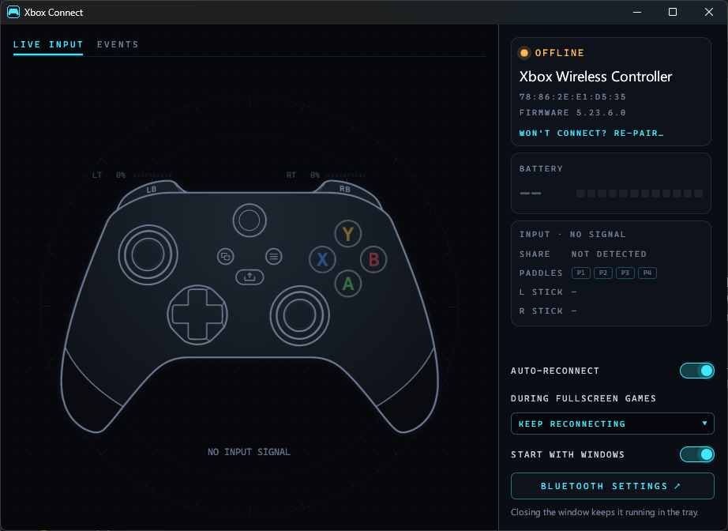
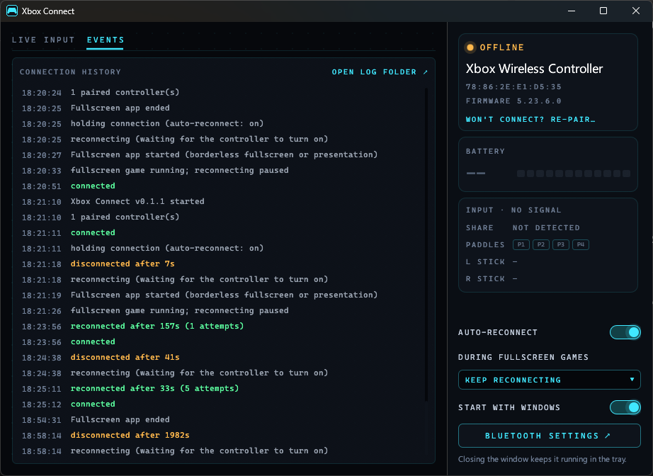

# Xbox Connect

A tiny Windows tray app that keeps Xbox Wireless Controllers connected over Bluetooth, and shows a live view of the controller: battery, firmware and every button you press.



## Why

On some Bluetooth adapters (for example the Realtek RTL8852BE found on many motherboards), a paired Xbox Series controller never reconnects after it's switched off and on, so you have to re-pair it every time. When the controller wakes it calls out to its PC for a few seconds, and Windows' background auto-connect on these adapters doesn't answer.

Xbox Connect does what Linux does: while a controller is missing it **keeps a connection attempt pending at all times**, so the controller is picked up the moment it calls out, and it holds the connection open (`GattSession.MaintainConnection`) from then on. Turn the controller on, tap the Xbox button, and it connects.

## Features

- Keeps **all** paired Xbox controllers connected; survives sleep/resume, Bluetooth being toggled, and re-pairing.
- **Pair / re-pair** from the app: press the controller's pair button and the app does the rest. An existing pairing is only replaced once the controller is actually in pairing mode, so cancelling never leaves you worse off.
- **During fullscreen games** setting: keep reconnecting, slow down (one try every 20 s, so the shared Wi-Fi/Bluetooth radio stays free; a controller switched on mid-game may take longer), or pause the app's own attempts until you leave the game (Windows' slower built-in reconnect may still pick the controller up). "Fullscreen" is what Windows reports for its own notifications: games in exclusive or borderless fullscreen on the main display, and also fullscreen video or presentations.
- **Events** tab with the connection history, also written to `%LOCALAPPDATA%\XboxConnect\events.log` (rolled over to `events.old.log` at 256 KB). Attach it to bug reports.

  
- Battery percentage straight from the controller (Bluetooth GATT), plus firmware version.
- Live input view: sticks, triggers (analog), bumpers, D-pad, ABXY, View/Menu/Share, Guide, and Elite paddles.
- System tray icon (cyan when connected) with a battery tooltip. Closing the window keeps it running in the tray.
- Start with Windows (optional).
- One small `.exe`, per-user install, no admin, no installer framework.

## Install

In PowerShell:

```powershell
irm https://raw.githubusercontent.com/ic3man5/xbox-connect/main/install.ps1 | iex
```

This downloads the latest release to `%LOCALAPPDATA%\Programs\XboxConnect`, verifies its SHA-256 checksum, adds a Start Menu shortcut, enables start-with-Windows and launches it.

Prefer to look before you run? Download [`install.ps1`](install.ps1), read it, then run it. To pin a version, set `$env:XBOX_CONNECT_VERSION = 'v0.1.1'` first. Release binaries carry [GitHub build attestations](https://docs.github.com/actions/security-guides/using-artifact-attestations-to-establish-provenance-for-builds); verify with `gh attestation verify xbox-connect.exe -R ic3man5/xbox-connect`.

> The checksum is published in the same release, so it protects against corrupted downloads, not a compromised repository. The attestation ties the binary to this repo's CI build.

The `.exe` isn't code-signed yet. If you download it from the Releases page in a browser, SmartScreen may say "Windows protected your PC"; choose **More info → Run anyway**.

## Uninstall

```powershell
irm https://raw.githubusercontent.com/ic3man5/xbox-connect/main/uninstall.ps1 | iex
```

Or use **Settings → Apps → Installed apps → Xbox Connect** (runs the local copy of the uninstaller saved at install time).

## Usage

1. Pair the controller once: in Xbox Connect click **Pair a controller** (or use **Settings → Bluetooth & devices**), then hold the pair button on top of the controller until the Xbox button flashes fast.
2. Leave Xbox Connect running. From then on, tap the Xbox button to reconnect.
3. If the controller ever stops connecting, check the **Events** tab; if it says the pairing looks lost, click **Re-pair controller**.

Command-line flags: `--minimized` starts hidden in the tray (used for start-with-Windows); `--demo` animates fake input, for screenshots.

## Build

```powershell
cargo build --release
```

Requires Rust (stable) on Windows. Output: `target\release\xbox-connect.exe`.

## Notes

- The Guide button is read through an undocumented XInput export (`xinput1_4.dll` ordinal 100); everything else uses documented Windows APIs.
- With several controllers, the input view follows whichever controller you used most recently.
- Controller drawing: "Gamepad Line Art Pack" by gidedin (https://gidedin.itch.io/gamepad-line-art-pack), CC0 1.0. See [assets/LICENSE-gamepad-line-art.txt](assets/LICENSE-gamepad-line-art.txt).
- This project is not affiliated with or endorsed by Microsoft. Xbox is a trademark of Microsoft Corporation.

## License

MIT
